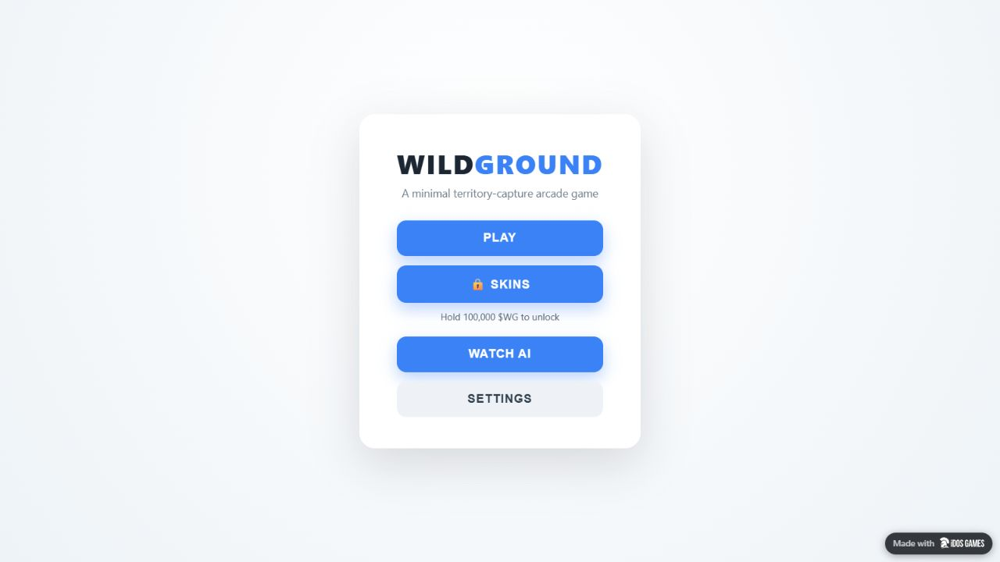
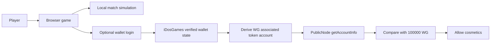

# WildGround

> A browser territory-capture arcade game with animal skins unlocked by holding 100,000 WG on Solana.

[Play the live game](https://idosgames.com/app/XCQ1T7X1/) · [Presentation](deliverables/WildGround-Pitch.pptx) · [Architecture](docs/architecture.md) · [Demo guide](docs/demo.md)



## Project and team

A playable MVP published on iDosGames. This repository follows the organization of [Marakaya's Colosseum example](https://github.com/Marakaya/colosseum_example), without claiming hackathon acceptance or copying its achievements.

| Name | Role | Contact |
| --- | --- | --- |
| Adam | Founder | [Telegram @satoryX](https://t.me/satoryX) |

## Problem and solution

**Design hypothesis:** casual players should be able to try a game immediately, while token holders can express their identity through optional cosmetics. Demand for this combination still needs player research.

WildGround puts PLAY first. Start a match without a wallet. The separate SKINS flow verifies the connected Solana wallet and reads its WG balance. Eligible players choose an animal that changes their head, trail color and repeating territory pattern. Skins do not change speed, turn rate or collision size.

## Why Solana

WG is an existing SPL token. The client derives the connected wallet's associated token account and reads it with `getAccountInfo`. A signed login message proves control of the address. Checking holdings does not transfer or burn tokens.

Gameplay runs locally in the browser. There is no custom on-chain game program, staking mechanism or match transaction.

Mint: [`3hZ7a3r5ghQPnceqyjj4KTKi3yneWeKMmSTsqxX4idos`](https://explorer.solana.com/address/3hZ7a3r5ghQPnceqyjj4KTKi3yneWeKMmSTsqxX4idos)

## Summary of features

- Territory capture, enemy trail cutting, elimination and win conditions.
- Human PLAY against 1–6 bots, with keyboard, mouse and touch controls.
- WATCH AI with 2–4 bots, camera follow, zoom and simulation speed controls.
- Four rule-based personalities: Balanced, Aggressive, Cautious and Opportunist.
- Nine animal skins plus free Classic appearance.
- Emoji heads and territories filled with the selected animal.
- Optional wallet login and the 100,000 WG cosmetic threshold.
- Balance refresh on focus, every visible minute and before a connected player starts a match.
- Minimap, leaderboard, pause, restart and debug tools.

Custom AI and fly connectome entries are extension templates, not trained models.

## Tech stack

| Layer | Technology |
| --- | --- |
| Game and UI | TypeScript, HTML, CSS, Canvas 2D |
| Build | Vite |
| Wallet authentication | `@idosgames/core`, `@idosgames/wallet` |
| Address derivation | `@solana/addresses` |
| Balance | Solana JSON-RPC through PublicNode |
| Hosting | iDosGames, Title `XCQ1T7X1` |
| Tests | Vitest |

## Architecture



See [architecture](docs/architecture.md) and [token access](docs/token-access.md) for the actual trust boundary.

## Quick start

Prerequisites: Node.js **22.12+**, npm and a modern browser.

```bash
git clone https://github.com/lekalerta-a11y/wildground.git
cd wildground
npm ci
npm run dev
```

Normal local play needs no API keys or environment file. Wallet features additionally require the configured title, network access and a compatible wallet. Standalone login supports Phantom. The iDosGames page uses its platform wallet bridge.

```bash
npm test
npm run build -- --base=./
npm run preview
```

Build output: `dist/`. See [deployment](docs/deployment.md).

## Repository structure

```text
src/core/       Simulation, territories, players, skins and WG verification
src/ai/         Perception and bot manager
src/brains/     Rule-based strategies and extension templates
src/input/      Keyboard, mouse and touch
src/render/     Canvas, camera, particles and minimap
src/ui/         HUD and menus
src/test/       Vitest regression tests
public/         Static icons
assets/         WG branding
server/         Unused CloudCode alternative
docs/           Architecture, demo, roadmap and evidence
deliverables/   Pitch deck and slide previews
.github/        CI and contribution templates
```

The application remains at the root so existing commands keep working. It has no required backend or custom Solana programs.

## Roadmap

- [x] Publish playable MVP.
- [x] Add bot choices and animal cosmetics.
- [x] Publish direct RPC WG access.
- [ ] Verify the full unlock with a real holder of at least 100,000 WG.
- [ ] Measure onboarding, voluntary replay and cosmetic activation.
- [ ] Improve RPC resilience and extra-account support if needed.
- [ ] Explore multiplayer after validating demand.

The gate reads the **standard associated token account only**. Extra token accounts, staking and custodial balances are not counted. This is a client-side cosmetic gate, not a server-enforced entitlement. See [roadmap](docs/roadmap.md).

## Resources

- [Live application](https://idosgames.com/app/XCQ1T7X1/)
- [Direct game](https://xcq1t7x1.idos.games/)
- [Pitch deck](deliverables/WildGround-Pitch.pptx)
- [Slide previews](deliverables/slides/)
- [Gameplay guide](docs/gameplay.md)
- [Evidence and sources](docs/evidence.md)
- [Founder](https://t.me/satoryX)

## License and attribution

A project license has not yet been selected. Do not assume this repository grants an open-source license. Third-party packages retain their own licenses.

Documentation organization follows [colosseum_example](https://github.com/Marakaya/colosseum_example). The pitch follows [Superteam's template](https://docs.google.com/presentation/d/1V9yq8B1nLpF8vPTL2buT_nlmsMwNJ_fRuyADs_k49Sg/edit), with evidence guidance from [ProofPilot](https://github.com/Marakaya/proofpilot). No affiliation or endorsement is implied.
